# Clustering and clinical phenotyping

## Purpose

Clinical phenotyping uses prespecified features to discover structure in
a training cohort, then places later participants in that **fixed**
phenotype space. Clustering is exploratory: fit indices, internal
stability, and clean projection do not establish that a phenotype is
biologically real. Clinical interpretation and independent-cohort
validation remain essential.

Every pipeline in this package uses the same train-once/project-many
contract:

- preprocessing and model parameters are learned from training data
  only;
- `DataWithClusters` preserves the original row order and columns;
- incomplete cases remain in the output with `NA` assignments;
- 90% participant subsample stability refits the **entire pipeline**,
  including scaling and PCA/MCA when present;
- fit, membership uncertainty or distance, and projection support are
  reviewed before phenotypes are named.

`method = "exploratory"` (or the shorter alias `"explore"`) compares
candidate settings and gives an advisory AHP-style recommendation. The
researcher then creates an explicit `method = "finalize"` model for
projection.

Lifecycle-specific settings are strict. Exploratory ranges (`k_range`,
`models`, `minPts_range`, and epsilon grids) cannot be supplied to a
finalized fit; finalized settings (`final_k`, `final_model`,
`final_minPts`, and final epsilon) cannot be supplied to exploratory
review. This catches calls that would otherwise look valid while
silently ignoring part of the request.

### Breaking output-name changes

The unreleased clustering interface now uses `DataWithClusters` rather
than `df_with_clusters`, and `ClusterVariableName` rather than
`ClusterName`. `ModelInfo_MClust` is the only correctly cased
Mclust-specific field; the erroneous `ModelInfo_Mclust` field has been
removed. `complete_rows`, `CandidateAudit` and the old `.scidr_rowid`
column are no longer public outputs. Every row-level output instead
carries a merge-safe `.row_id`, labeled `"Row ID"`. Use
`Specification$n_complete` for aggregate training support and the
`fit_table` status/warning/error columns to audit candidates. For
example, merge diagnostics back without relying on row order using
`dplyr::left_join(model$DataWithClusters, model$ProbFit$individual, by = ".row_id")`.

Every method stores its figures in the same places, so the same review
sequence works whichever approach you choose. A figure lives beside the
table it summarises rather than in one flat list:

| Location | What it shows |
|----|----|
| `fit_plot` | candidate solutions across the search grid |
| `ModelInfo$plots` | structure of the selected solution |
| `ModelInfo$FitDiagnostics$plots` | how individual training cases sit inside that structure |
| `ProbFit$plots` | membership confidence |
| `Stability$plots` | 90% subsample reproducibility |
| `ProjectionFit$plots` | projected cases against the frozen training reference |

The *contents* are method-specific: K-means and Gower/PAM give you a
silhouette profile, Mclust a BIC curve and an uncertainty map, HDBSCAN a
persistence review, LCA item response profiles, and the reduction
pipelines a scree plot. The SOM pipeline keeps its own richer set,
including the interactive `aweSOM` maps in `ModelInfo_SOM$plots`.

## Choosing a method

| Method | Data and geometry | Primary diagnostics | Projection rule | Ideal situation | Main caveat |
|----|----|----|----|----|----|
| SOM + Mclust | Continuous; topology and gradients matter | map fit, posterior, SOM distance, stability | scaling → SOM node → mixture class | phenotype maps and nonlinear gradients | most complex workflow |
| Mclust | Continuous; Gaussian mixtures | BIC/ICL, entropy, posterior, stability | exact mixture posterior | probabilistic groups with different covariance | sensitive to distributional mismatch |
| PCA + Mclust | Correlated continuous measures | scree, mixture fit, posterior, stability | frozen PCA → mixture posterior | clustering a lower-dimensional signal space | PCs can obscure individual variables |
| K-means | Numeric; compact centroid geometry | WSS, silhouette, CH, margin, stability | nearest frozen centroid | simple, interpretable baseline | no probability model |
| PCA + K-means | Correlated numeric measures | scree, silhouette, distance, stability | frozen PCA → nearest centroid | fast reduced-space baseline | inherits PCA and K-means assumptions |
| HDBSCAN | Numeric; irregular or unequal-density groups | persistence, membership, noise, support | nearest eligible training core | clusters plus meaningful noise | conservative projection may label many cases noise |
| Gower + PAM | Mixed numeric/categorical/ordinal | silhouette, medoids, distance, stability | nearest frozen medoid | mixed clinical measures and exemplar participants | coding and variable selection define distance |
| LCA | Categorical response patterns | BIC, entropy, response probabilities, stability | latent-class posterior | symptom or questionnaire response phenotypes | local-independence assumption |
| MCA + Mclust | Nominal categorical measures | inertia, mixture fit, posterior, stability | frozen MCA → mixture posterior | reduced categorical response space | MCA dimensions can be abstract |

## Load the benchmark

> **Note**
>
> The data file is `SimulatedPhenotypeData`; the codebook is
> `SimulatedPhenotypeVariableTypes`. The benchmark contains 320 training
> and 160 projection participants. `TruthCluster`, `TruthDensityGroup`,
> and `Cohort` are never supplied to a clustering function. Truth is
> revealed only as a teaching check after fitting.

The 12 numeric measures are three indicators of each of four independent
simulated axes. The default 85% rule therefore retains at least four
PCs. Four balanced truth groups use different combinations of these
axes. Separate `DensityX`/`DensityY` coordinates contain two
unequal-density groups and noise; three categorical variables contain
deliberately strong class-dependent response patterns. That separation
is useful for checking implementation; it is intentionally easier than
most real categorical phenotyping problems.

## Constructor interface

All clustering constructors use `method = "exploratory"` to review
candidates and `method = "finalize"` to create a reusable model.
Fixed-count methods use `k_range` and `final_k`; density methods use
`minPts_range`, epsilon settings, and their matching finalized inputs.
Numeric methods use `ZScoreType`; `Scaling` is retained as a
compatibility alias and must agree if both are supplied.

| Workflow | Candidate settings | Finalized settings | Method-specific control |
|----|----|----|----|
| Mclust, PCA + Mclust, MCA + Mclust, SOM + Mclust | `k_range`, `models` | `final_k`, `final_model` | tidyLPA mclust models: 1 = EEI, 2 = VVI, 3 = EEE, 6 = VVV; models 4 and 5 require OpenMx and are unsupported |
| K-means, PCA + K-means, Gower + PAM, latent class | `k_range` | `final_k` | `nstart` for K-means; `nrep` for LCA |
| HDBSCAN, SOM + HDBSCAN | `minPts_range`, epsilon range | `final_minPts`, final epsilon | extracted class count is data-derived |

The tidyLPA Mclust model numbers describe which within-cluster variances
and covariances may differ between clusters:

| Model | mclust code | Meaning |
|----|----|----|
| Model 1 | EEI | Equal variance across clusters, with covariance fixed at zero |
| Model 2 | VVI | Varying variance across clusters, with covariance fixed at zero |
| Model 3 | EEE | Equal variance and equal covariance across clusters |
| Model 6 | VVV | Varying variance and varying covariance across clusters |

Zero covariance assumes the clustering variables are conditionally
independent within a cluster. Equal parameters pool the corresponding
structure across clusters; varying parameters let each cluster estimate
its own structure.

## Continuous workflows

> **Note**
>
> The non-SOM workflows below are complete, copyable templates, but
> their model fits are intentionally not evaluated while this vignette
> renders. This keeps package checks practical. Run one workflow at a
> time in an analysis project, then increase `stability_resamples` when
> the candidate solution is ready for a real stability assessment.

### Mclust

Gaussian mixture models provide posterior membership and allow clusters
to differ in covariance ([Scrucca et al. 2016](#ref-scrucca2016)).

> **Note**
>
> **When to use it:** continuous measures with approximately
> mixture-shaped groups. **Inspect before naming:** BIC/ICL, entropy,
> posterior confidence, small clusters, subsample ARI/Jaccard, and
> projected uncertainty.

### K-means

K-means is a useful scaled baseline for compact groups ([MacQueen
1967](#ref-macqueen1967)).

> **Note**
>
> **When to use it:** continuous features with roughly compact,
> similarly shaped groups. **Inspect before naming:** WSS, silhouette,
> Calinski–Harabasz index, centroid distance, assignment margin, and
> subsample stability.

### PCA followed by clustering

PCA concentrates correlated variation into orthogonal dimensions
([Jolliffe and Cadima 2016](#ref-jolliffe2016)). These pipelines refit
scaling and PCA inside every stability 90% subsampling, then use the
frozen training transformation for projection.

> **Note**
>
> **When to use it:** correlated continuous variables where a reduced
> signal space is clearer than the raw feature space. **Inspect before
> naming:** scree plot, retained component count/loadings, downstream
> fit and stability, score space separation, and projection distance or
> uncertainty.

### HDBSCAN

HDBSCAN is designed for irregular clusters, unequal density, and noise
([McInnes et al. 2017](#ref-mcinnes2017)). A projected `0` is an
out-of-support/noise assignment, not a new phenotype.

> **Note**
>
> **When to use it:** density structure is more plausible than centroid
> geometry and noise is scientifically meaningful. **Inspect before
> naming:** persistence, membership, noise burden, outlier scores,
> stability, and nearest-core support. All-noise candidates are valid
> negative results.

### SOM followed by Mclust

Self-organizing maps preserve local topology before mixture clustering
([Kohonen 1982](#ref-kohonen1982)).

> **Note**
>
> **When to use it:** a map of phenotype gradients is as useful as the
> final labels. **Inspect before naming:** map topology,
> quantization/SOM distance, node occupancy, posterior confidence,
> stability, and projected distance flags.

Ordinary SOM fitting defaults to `stability_resamples = 0`, so model
review does not unexpectedly become slow. Use the separate map-design
screen below before final cluster selection: it uses the largest
requested `k` to generate coarse, balanced, and fine candidate
resolutions (about 10, 20, and 30 nodes per maximum planned phenotype),
then holds each candidate grid and topology fixed within three 90%
subsample refits and projects every refit back to the full reference
cohort. This fast screen compares topology preservation, local
neighborhood overlap, projected SOM distance, and map occupancy; it fits
no Mclust model and does not choose a grid automatically. After
reviewing the result, freeze one grid/topology and compare the
clinically meaningful `k` values on that same map using fit indices,
participant-level ARI, and clinical interpretation. The screen reports
expected nodes per profile for every requested `k`; larger cohorts can
support a reviewed map, but do not by themselves require more map nodes
or more clinical phenotypes. Stability refits run in parallel by
default; set `stability_cores = 1L` for serial execution or a smaller
positive value when each SOM or high-dimensional refit needs more
memory.

For a finalized SOM + Mclust instrument, ARI is still the primary answer
to the narrow question, “do the refits recover the same final
participant partition?” `StabilityARI_P05` is the fifth percentile
across refits: a stress-test lower-tail summary, not a second selection
criterion. When an ARI is modest, inspect the stability panel rather
than relabeling that result as stable: `deletion_curve` shows
sensitivity at explicitly requested retained fractions, exact
memory-safe `co_membership_*` outputs distinguish within- phenotype
cohesion from cross-phenotype mixing, `split_merge_*` describes
fragmentation/merging, and `profile_recovery` compares matched phenotype
means on the frozen training scale. These explain whether membership
movement is localized while phenotype profiles are retained; none
replace the all-participant ARI. Boundary participants remain assigned
and included in that primary metric.

``` r

data("SimulatedPhenotypeData")

df_Training <- SimulatedPhenotypeData %>% dplyr::filter(Cohort == "Training")
df_Projection <- SimulatedPhenotypeData %>% dplyr::filter(Cohort == "Projection")
vars_Clust <- paste0("Var", 1:12)

Obj_ClustReview <- CreateClusterModel_SOM_MClust(
  df_Training, vars_Clust, k_range = 2:10, models = c(1, 3),
  method = "exploratory"
)
Obj_ClustFinal <- CreateClusterModel_SOM_MClust(
  df_Training, vars_Clust, final_k = 4, final_model = 3,
  method = "finalize", stability_resamples = 30
)
ObjClustProjected <- ProjectCluster(Obj_ClustFinal, df_Projection)
```

       Model Classes     LogLik parameters  n      AIC       AWE      BIC     CAIC
    1      1       2 -351.06784         37 25 776.1357 1049.4065 821.2341 858.2341
    2      3       2   72.51292        169 25 192.9742 1447.9542 398.9642 567.9642
    3      1       3 -277.85952         50 25 655.7190 1025.6102 716.6628 766.6628
    4      3       3   93.07687        182 25 177.8463 1529.5171 399.6817 581.6817
    5      1       4 -152.90811         63 25 431.8162  898.3946 508.6054 571.6054
    6      3       4  121.18864        195 25 147.6227 1595.9843 385.3035 580.3035
    7      1       5 -121.23197         76 25 394.4639  957.7331 487.0985 563.0985
    8      3       5  132.17612        208 25 151.6478 1696.7001 405.1739 613.1739
    9      1       6 -112.97339         89 25 403.9468 1063.9107 512.4267 601.4267
    10     3       6  132.01242        221 25 177.9752 1819.7243 447.3467 668.3467
    11     1       7 -118.45913        102 25 440.9183 1197.5701 565.2436 667.2436
    12     3       7  150.29455        234 25 167.4109 1905.8448 452.6278 686.6278
    13     1       8 -110.08009        115 25 450.1602 1303.5040 590.3309 705.3309
    14     3       8  157.93308        247 25 178.1338 2013.2585 479.1962 726.1962
    15     1       9 -100.13395        128 25 456.2679 1406.3006 612.2840 740.2840
    16     3       9  184.01651        260 25 151.9670 2083.7824 468.8747 728.8747
    17     1      10  -85.65194        141 25 453.3039 1500.0273 625.1654 766.1654
    18     3      10  193.34826        273 25 159.3035 2187.8097 492.0566 765.0566
             CLC      KIC     SABIC       ICL   Entropy  prob_min  prob_max
    1   704.0617 816.1357  706.4937 -821.8855 0.9629876 0.9553981 0.9999889
    2  -143.0258 364.9742 -125.1205 -398.9642 1.0000000 1.0000000 1.0000000
    3   557.7155 708.7190  561.6082 -716.6779 0.9982285 0.9990952 0.9999986
    4  -184.1537 362.8463 -164.7172 -399.6817 0.9999973 0.9999996 1.0000000
    5   307.8162 497.8162  313.2365 -508.6054 1.0000000 1.0000000 1.0000000
    6  -240.3773 345.6227 -219.4096 -385.3035 0.9999977 0.9999992 1.0000000
    7   244.4639 473.4639  251.4155 -487.0985 1.0000000 1.0000000 1.0000000
    8  -262.3523 362.6478 -239.8534 -405.1740 0.9999933 0.9999963 1.0000000
    9   227.9428 495.9468  236.4295 -512.4582 0.9979917 0.9960938 1.0000000
    10 -262.0309 401.9752 -237.9948 -447.3914 0.9969976 0.9971487 1.0000000
    11  238.9171 545.9183  248.9321 -565.2508 0.9994202 0.9982046 1.0000000
    12 -298.5891 404.4109 -273.0279 -452.6278 0.9999994 0.9999994 1.0000000
    13  222.1578 568.1602  233.7052 -590.3498 0.9987990 0.9983064 1.0000000
    14 -313.8662 428.1338 -286.7738 -479.1962 0.9999962 0.9999942 1.0000000
    15  202.2674 587.2679  215.3441 -612.2874 0.9997389 0.9994257 1.0000000
    16 -366.0330 414.9670 -337.4094 -468.8747 0.9999966 0.9999924 1.0000000
    17  173.3035 597.3039  187.9113 -625.1683 0.9998065 0.9986208 1.0000000
    18 -384.6965 435.3035 -354.5417 -492.0566 0.9999992 0.9999966 1.0000000
       BLRTStatistic BLRTPValue MinProfileNodeN MaxProfileNodeN
    1             NA         NA               6              19
    2             NA         NA               6              19
    3             NA         NA               6              13
    4             NA         NA               6              13
    5             NA         NA               5               8
    6             NA         NA               5               8
    7             NA         NA               2               6
    8             NA         NA               4               6
    9             NA         NA               2               6
    10            NA         NA               2               6
    11            NA         NA               1               6
    12            NA         NA               1               6
    13            NA         NA               1               6
    14            NA         NA               1               5
    15            NA         NA               1               6
    16            NA         NA               1               5
    17            NA         NA               1               5
    18            NA         NA               1               5
       MinProfileNodeProportion MaxProfileNodeProportion MinProfileParticipantN
    1                      0.24                     0.76                     80
    2                      0.24                     0.76                     80
    3                      0.24                     0.52                     80
    4                      0.24                     0.52                     80
    5                      0.20                     0.32                     80
    6                      0.20                     0.32                     80
    7                      0.08                     0.24                      0
    8                      0.16                     0.24                     30
    9                      0.08                     0.24                      0
    10                     0.08                     0.24                     27
    11                     0.04                     0.24                      8
    12                     0.04                     0.24                     21
    13                     0.04                     0.24                      8
    14                     0.04                     0.20                     21
    15                     0.04                     0.24                      3
    16                     0.04                     0.20                      3
    17                     0.04                     0.20                      3
    18                     0.04                     0.20                      3
       MinProfileParticipantProportion PosteriorMean PosteriorMedian
    1                         0.250000     0.9999309       0.9999990
    2                         0.250000     1.0000000       1.0000000
    3                         0.250000     1.0000000       1.0000000
    4                         0.250000     1.0000000       1.0000000
    5                         0.250000     1.0000000       1.0000000
    6                         0.250000     1.0000000       1.0000000
    7                         0.000000     1.0000000       1.0000000
    8                         0.093750     0.9999992       1.0000000
    9                         0.000000     0.9990130       1.0000000
    10                        0.084375     0.9986431       1.0000000
    11                        0.025000     0.9998089       0.9999998
    12                        0.065625     0.9999998       1.0000000
    13                        0.025000     0.9996616       0.9999992
    14                        0.065625     0.9999992       1.0000000
    15                        0.009375     0.9999342       0.9999998
    16                        0.009375     0.9999992       1.0000000
    17                        0.009375     0.9999504       1.0000000
    18                        0.009375     0.9999999       1.0000000
       PropLowPosterior StabilitySuccessRate StabilityARI_Mean StabilityARI_P05
    1                 0                    1         0.4656616      -0.01524288
    2                 0                    1         0.4656616      -0.01524288
    3                 0                    1         0.4624432       0.46116314
    4                 0                    1         0.4624432       0.46116314
    5                 0                    1         0.9958202       0.99205833
    6                 0                    1         0.9958202       0.99205833
    7                 0                    1         0.9897228       0.98047339
    8                 0                    1         0.8956853       0.86045376
    9                 0                    1         0.9151670       0.90782561
    10                0                    1         0.7626110       0.67909257
    11                0                    1         0.8016879       0.77806202
    12                0                    1         0.7225818       0.69660212
    13                0                    1         0.6866398       0.66857645
    14                0                    1         0.7317106       0.69663241
    15                0                    1         0.6493978       0.62649461
    16                0                    1         0.6964294       0.65997935
    17                0                    1         0.7380422       0.70948639
    18                0                    1         0.7594990       0.75070975
       StabilityJaccard_Mean StabilityJaccard_Min StabilityCoreProportion
    1              0.7083333           0.66666667                       1
    2              0.7083333           0.66666667                       1
    3              0.6651074           0.49687500                       1
    4              0.6651074           0.49687500                       1
    5              0.9968943           0.99375000                       1
    6              0.9968943           0.99375000                       1
    7              0.9921875           0.97500000                       1
    8              0.7725000           0.25000000                       1
    9              0.7946044           0.31875000                       1
    10             0.6132120           0.23750000                       1
    11             0.6032487           0.23259494                       1
    12             0.5920687           0.28149693                       1
    13             0.4869087           0.11164954                       1
    14             0.6426372           0.28149693                       1
    15             0.4195441           0.03750000                       1
    16             0.5609762           0.04592363                       1
    17             0.5611938           0.03835784                       1
    18             0.6494702           0.04592363                       1
       StabilityARI_Core StabilityJaccard_CoreMean StabilityJaccard_CoreMin
    1          0.4656616                 0.7083333               0.66666667
    2          0.4656616                 0.7083333               0.66666667
    3          0.4624432                 0.6651074               0.49687500
    4          0.4624432                 0.6651074               0.49687500
    5          0.9958202                 0.9968943               0.99375000
    6          0.9958202                 0.9968943               0.99375000
    7          0.9897228                 0.9921875               0.97500000
    8          0.8956853                 0.7725000               0.25000000
    9          0.9151670                 0.7946044               0.31875000
    10         0.7626110                 0.6132120               0.23750000
    11         0.8016879                 0.6032487               0.23259494
    12         0.7225818                 0.5920687               0.28149693
    13         0.6866398                 0.4869087               0.11164954
    14         0.7317106                 0.6426372               0.28149693
    15         0.6493978                 0.4195441               0.03750000
    16         0.6964294                 0.5609762               0.04592363
    17         0.7380422                 0.5611938               0.03835784
    18         0.7594990                 0.6494702               0.04592363
       StabilityNonBoundaryProportion StabilityARI_NonBoundary
    1                        1.000000                0.4656616
    2                        1.000000                0.4656616
    3                        1.000000                0.4624432
    4                        1.000000                0.4624432
    5                        1.000000                0.9958202
    6                        1.000000                0.9958202
    7                        1.000000                0.9897228
    8                        0.962500                0.9103017
    9                        0.993750                0.9170130
    10                       0.956250                0.7682828
    11                       0.978125                0.8135826
    12                       0.937500                0.7363608
    13                       0.968750                0.6955504
    14                       0.928125                0.7469045
    15                       0.968750                0.6564588
    16                       0.928125                0.7070187
    17                       0.962500                0.7468363
    18                       0.921875                0.7678478
       StabilityARI_NonBoundary_P05 StabilityJaccard_NonBoundaryMean
    1                   -0.01524288                        0.7083333
    2                   -0.01524288                        0.7083333
    3                    0.46116314                        0.6651074
    4                    0.46116314                        0.6651074
    5                    0.99205833                        0.9968943
    6                    0.99205833                        0.9968943
    7                    0.98047339                        0.9921875
    8                    0.87298331                        0.7725000
    9                    0.90954936                        0.7945837
    10                   0.67788872                        0.6131948
    11                   0.78985527                        0.6041955
    12                   0.70457768                        0.5922588
    13                   0.67774734                        0.4876779
    14                   0.71257501                        0.6452262
    15                   0.63276808                        0.4201939
    16                   0.66837196                        0.5607031
    17                   0.71759872                        0.5634501
    18                   0.75732105                        0.6521223
       StabilityJaccard_NonBoundaryMin ReproducibilityScore_All
    1                       0.66666667                0.4656616
    2                       0.66666667                0.4656616
    3                       0.49687500                0.4624432
    4                       0.49687500                0.4624432
    5                       0.99375000                0.9958202
    6                       0.99375000                0.9958202
    7                       0.97500000                0.9897228
    8                       0.23529412                0.8956853
    9                       0.32692308                0.9151670
    10                      0.22058824                0.7626110
    11                      0.20000000                0.8016879
    12                      0.27525253                0.7225818
    13                      0.11164954                0.6866398
    14                      0.27525253                0.7317106
    15                      0.03896104                0.6493978
    16                      0.04861111                0.6964294
    17                      0.04031385                0.7380422
    18                      0.04861111                0.7594990
       ReproducibilityScore BoundaryParticipantProportion
    1             0.4656616                      0.000000
    2             0.4656616                      0.000000
    3             0.4624432                      0.000000
    4             0.4624432                      0.000000
    5             0.9958202                      0.000000
    6             0.9958202                      0.000000
    7             0.9897228                      0.000000
    8             0.8956853                      0.037500
    9             0.9151670                      0.006250
    10            0.7626110                      0.043750
    11            0.8016879                      0.021875
    12            0.7225818                      0.062500
    13            0.6866398                      0.031250
    14            0.7317106                      0.071875
    15            0.6493978                      0.031250
    16            0.6964294                      0.071875
    17            0.7380422                      0.037500
    18            0.7594990                      0.078125
       MaxClusterBoundaryProportion MixtureParameters MixtureNodes
    1                    0.00000000                37           25
    2                    0.00000000               103           25
    3                    0.00000000                50           25
    4                    0.00000000               116           25
    5                    0.00000000                63           25
    6                    0.00000000               129           25
    7                    0.00000000                76           25
    8                    0.20000000               142           25
    9                    0.03703704                89           25
    10                   0.21052632               155           25
    11                   0.20000000               102           25
    12                   0.21052632               168           25
    13                   0.20000000               115           25
    14                   0.21052632               181           25
    15                   0.20000000               128           25
    16                   0.21052632               194           25
    17                   0.20000000               141           25
    18                   0.21052632               207           25
       ParticipantsPerNode OccupancyCompliant NodesPerParameter Overparameterized
    1                 12.8               TRUE         0.6756757              TRUE
    2                 12.8               TRUE         0.2427184              TRUE
    3                 12.8               TRUE         0.5000000              TRUE
    4                 12.8               TRUE         0.2155172              TRUE
    5                 12.8               TRUE         0.3968254              TRUE
    6                 12.8               TRUE         0.1937984              TRUE
    7                 12.8               TRUE         0.3289474              TRUE
    8                 12.8               TRUE         0.1760563              TRUE
    9                 12.8               TRUE         0.2808989              TRUE
    10                12.8               TRUE         0.1612903              TRUE
    11                12.8               TRUE         0.2450980              TRUE
    12                12.8               TRUE         0.1488095              TRUE
    13                12.8               TRUE         0.2173913              TRUE
    14                12.8               TRUE         0.1381215              TRUE
    15                12.8               TRUE         0.1953125              TRUE
    16                12.8               TRUE         0.1288660              TRUE
    17                12.8               TRUE         0.1773050              TRUE
    18                12.8               TRUE         0.1207729              TRUE
            SupportStatus AIC_scaled  BIC_scaled Entropy_scaled
    1  over-parameterized -2.3217180 -2.57142713    -3.98596017
    2  over-parameterized  0.7235624  1.03870975     0.29597332
    3  over-parameterized -1.6928999 -1.67740986     0.09103470
    4  over-parameterized  0.8025605  1.03257570     0.29566559
    5  over-parameterized -0.5236752  0.10134775     0.29597317
    6  over-parameterized  0.9603884  1.15549972     0.29570174
    7  over-parameterized -0.3286210  0.28521775     0.29597333
    8  over-parameterized  0.9393696  0.98562035     0.29519501
    9  over-parameterized -0.3781406  0.06867773     0.06363850
    10 over-parameterized  0.8018875  0.62507018    -0.05137539
    11 over-parameterized -0.5712063 -0.38287255     0.22890167
    12 over-parameterized  0.8570542  0.57991985     0.29590390
    13 over-parameterized -0.6194677 -0.59735287     0.15702885
    14 over-parameterized  0.8010588  0.35277774     0.29553557
    15 over-parameterized -0.6513624 -0.78503789     0.26576360
    16 over-parameterized  0.9377027  0.44101974     0.29557465
    17 over-parameterized -0.6358843 -0.89516541     0.27359220
    18 over-parameterized  0.8993913  0.24282944     0.29587976
       Reproducibility_scaled Posterior_scaled  ahp_index Eligible Recommended
    1            -1.460958081       0.26536601 -2.5850158    FALSE       FALSE
    2            -1.460958081       0.44719763  0.1493218    FALSE       FALSE
    3            -1.478535111       0.44719716 -1.1894526    FALSE       FALSE
    4            -1.478535111       0.44719763  0.1630667    FALSE       FALSE
    5             1.434447183       0.44719763  0.3270232    FALSE       FALSE
    6             1.434447183       0.44719763  0.9615093    FALSE       FALSE
    7             1.401147205       0.44719762  0.4134293    FALSE       FALSE
    8             0.887571052       0.44515837  0.7769390    FALSE       FALSE
    9             0.993968265      -2.14876252  0.1870360    FALSE       FALSE
    10            0.160799529      -3.12154031  0.3840955    FALSE       FALSE
    11            0.374213962      -0.05534519 -0.0877408    FALSE       FALSE
    12           -0.057815682       0.44678403  0.4187656    FALSE       FALSE
    13           -0.254108935      -0.44289951 -0.3284752    FALSE       FALSE
    14           -0.007959829       0.44513967  0.3603531    FALSE       FALSE
    15           -0.457502390       0.27411167 -0.4070348    FALSE       FALSE
    16           -0.200644329       0.44504462  0.3684132    FALSE       FALSE
    17            0.026619558       0.31686578 -0.3077095    FALSE       FALSE
    18            0.143803611       0.44689206  0.3954760    FALSE       FALSE
          GridDesignPolicy GridDesignK TargetNodesPerProfile SOMNodeCount
    1  explicit_dimensions          10                    20           25
    2  explicit_dimensions          10                    20           25
    3  explicit_dimensions          10                    20           25
    4  explicit_dimensions          10                    20           25
    5  explicit_dimensions          10                    20           25
    6  explicit_dimensions          10                    20           25
    7  explicit_dimensions          10                    20           25
    8  explicit_dimensions          10                    20           25
    9  explicit_dimensions          10                    20           25
    10 explicit_dimensions          10                    20           25
    11 explicit_dimensions          10                    20           25
    12 explicit_dimensions          10                    20           25
    13 explicit_dimensions          10                    20           25
    14 explicit_dimensions          10                    20           25
    15 explicit_dimensions          10                    20           25
    16 explicit_dimensions          10                    20           25
    17 explicit_dimensions          10                    20           25
    18 explicit_dimensions          10                    20           25
       ExpectedNodesPerProfile
    1                12.500000
    2                12.500000
    3                 8.333333
    4                 8.333333
    5                 6.250000
    6                 6.250000
    7                 5.000000
    8                 5.000000
    9                 4.166667
    10                4.166667
    11                3.571429
    12                3.571429
    13                3.125000
    14                3.125000
    15                2.777778
    16                2.777778
    17                2.500000
    18                2.500000

    [1] "No eligible SOM mixture candidate is available for composite recommendation."

    # A tibble: 18 × 18
       Model Classes StabilitySuccessRate StabilityARI_Mean StabilityARI_P05
       <int>   <int>                <dbl>             <dbl>            <dbl>
     1     1       2                    1             0.466          -0.0152
     2     3       2                    1             0.466          -0.0152
     3     1       3                    1             0.462           0.461
     4     3       3                    1             0.462           0.461
     5     1       4                    1             0.996           0.992
     6     3       4                    1             0.996           0.992
     7     1       5                    1             0.990           0.980
     8     3       5                    1             0.896           0.860
     9     1       6                    1             0.915           0.908
    10     3       6                    1             0.763           0.679
    11     1       7                    1             0.802           0.778
    12     3       7                    1             0.723           0.697
    13     1       8                    1             0.687           0.669
    14     3       8                    1             0.732           0.697
    15     1       9                    1             0.649           0.626
    16     3       9                    1             0.696           0.660
    17     1      10                    1             0.738           0.709
    18     3      10                    1             0.759           0.751
    # ℹ 13 more variables: StabilityJaccard_Mean <dbl>, StabilityJaccard_Min <dbl>,
    #   StabilityCoreProportion <dbl>, StabilityARI_Core <dbl>,
    #   StabilityJaccard_CoreMean <dbl>, StabilityJaccard_CoreMin <dbl>,
    #   StabilityNonBoundaryProportion <dbl>, StabilityARI_NonBoundary <dbl>,
    #   StabilityARI_NonBoundary_P05 <dbl>, StabilityJaccard_NonBoundaryMean <dbl>,
    #   StabilityJaccard_NonBoundaryMin <dbl>, ReproducibilityScore_All <dbl>,
    #   ReproducibilityScore <dbl>

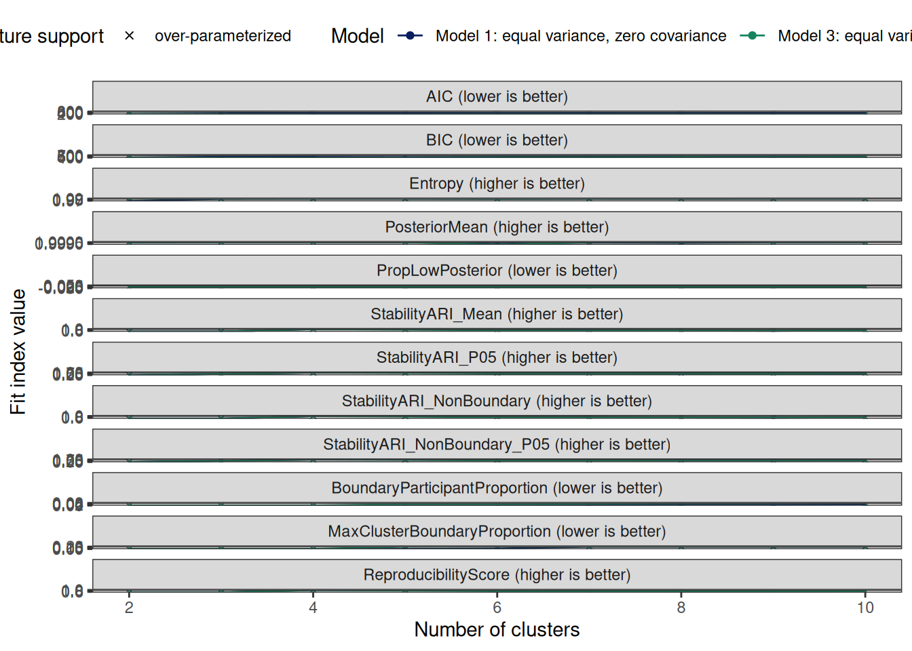

##### 

##### 


##### 

##### 


##### 

##### 


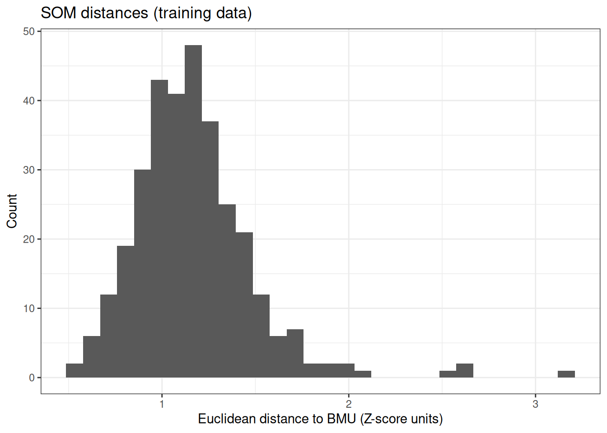

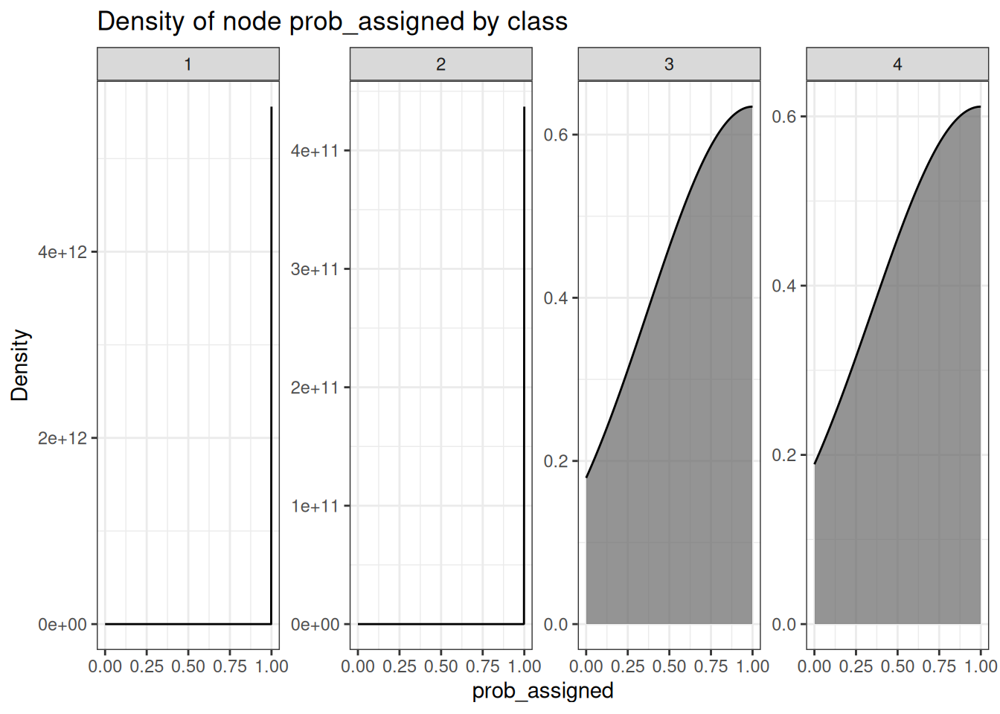

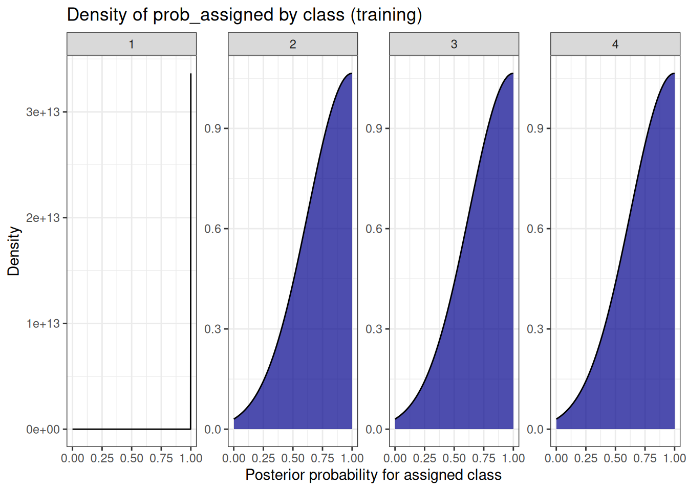

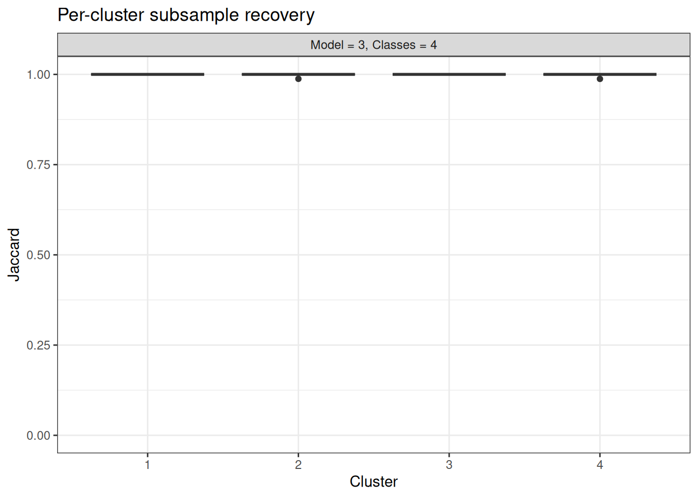

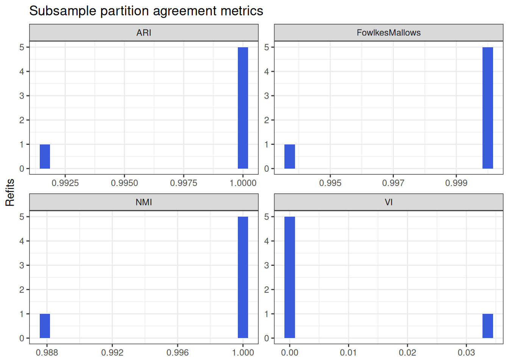

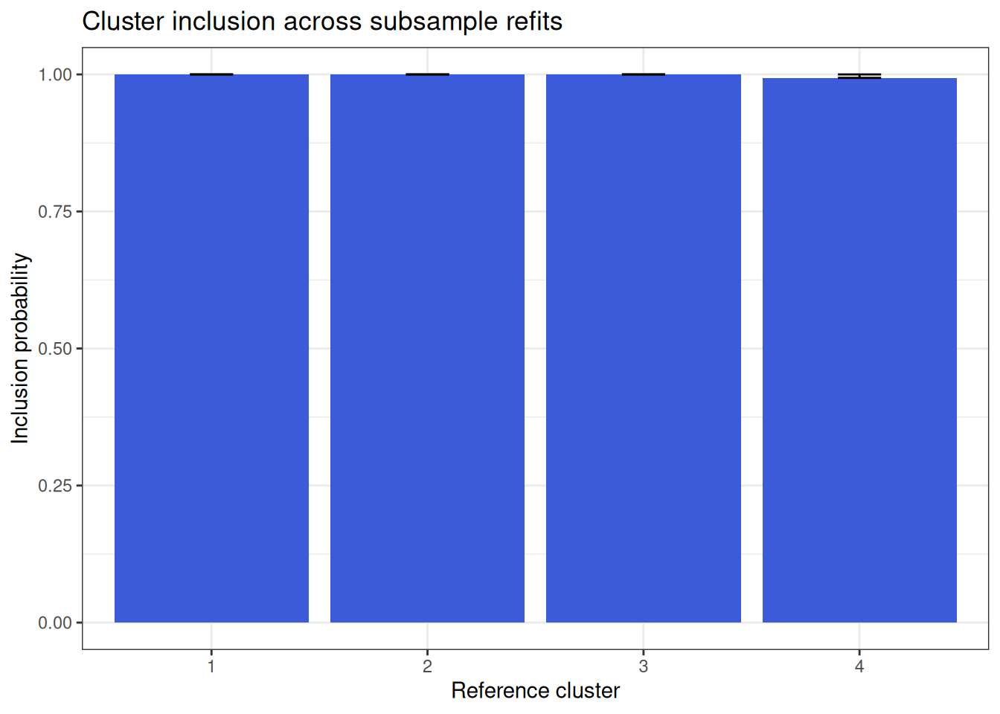

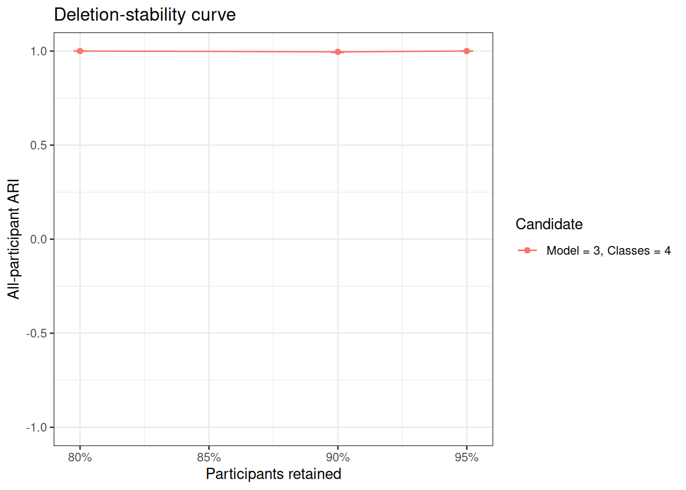

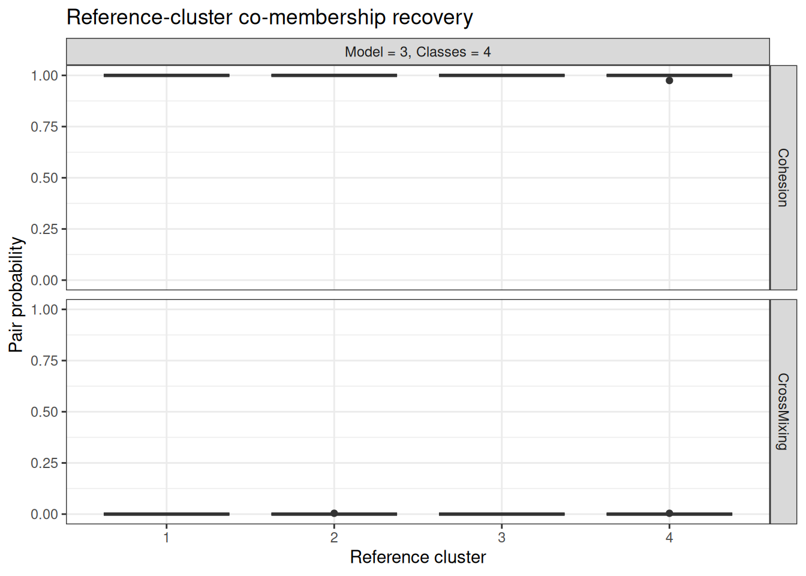

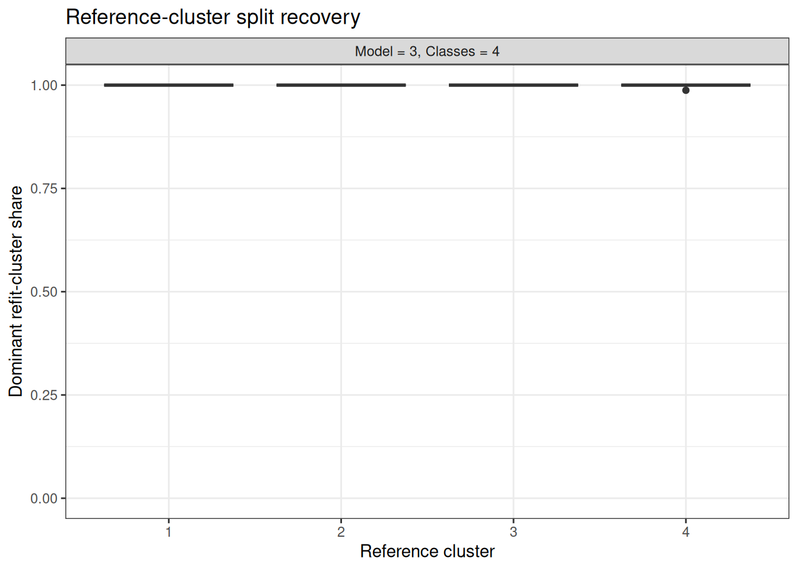

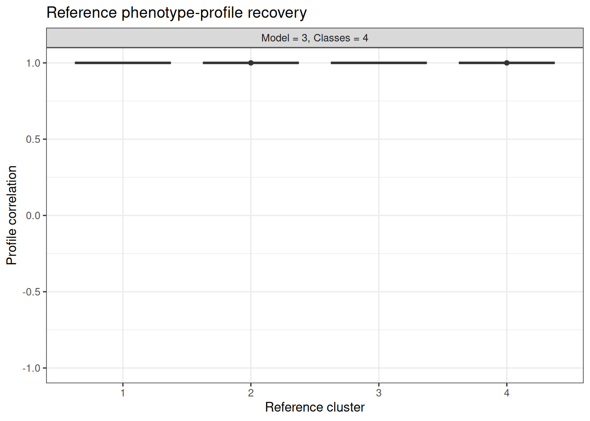

    # A tibble: 3 × 9
      Model Classes RetainedFraction StabilitySuccessRate StabilityARI_Mean
      <int>   <int>            <dbl>                <dbl>             <dbl>
    1     3       4             0.8                     1             1
    2     3       4             0.9                     1             0.996
    3     3       4             0.95                    1             1
    # ℹ 4 more variables: StabilityARI_P05 <dbl>, StabilityVI_Mean <dbl>,
    #   StabilityNMI_Mean <dbl>, StabilityFowlkesMallows_Mean <dbl>

    # A tibble: 24 × 8
       ReferenceCluster ReferenceParticipants Cohesion CrossMixing Model Classes
                  <int>                 <dbl>    <dbl>       <dbl> <int>   <int>
     1                1                    80    1         0           3       4
     2                2                    80    1         0           3       4
     3                3                    80    1         0           3       4
     4                4                    80    1         0           3       4
     5                1                    80    1         0           3       4
     6                2                    80    1         0.00417     3       4
     7                3                    80    1         0           3       4
     8                4                    80    0.975     0.00417     3       4
     9                1                    80    1         0           3       4
    10                2                    80    1         0           3       4
    # ℹ 14 more rows
    # ℹ 2 more variables: Replicate <int>, RetainedFraction <dbl>

    # A tibble: 24 × 9
       ReferenceCluster DominantRefitCluster DominantRefitShare
                  <int>                <int>              <dbl>
     1                1                    3              1
     2                2                    4              1
     3                3                    1              1
     4                4                    2              1
     5                1                    1              1
     6                2                    4              1
     7                3                    3              1
     8                4                    2              0.988
     9                1                    4              1
    10                2                    1              1
    # ℹ 14 more rows
    # ℹ 6 more variables: EffectiveRefitClusters <dbl>, BestJaccard <dbl>,
    #   Model <int>, Classes <int>, Replicate <int>, RetainedFraction <dbl>

    # A tibble: 24 × 8
       ReferenceCluster MatchedRefitCluster ProfileCorrelation ProfileRMSE Model
                  <int>               <int>              <dbl>       <dbl> <int>
     1                1                   3              1          0          3
     2                2                   4              1          0          3
     3                3                   1              1          0          3
     4                4                   2              1          0          3
     5                1                   1              1          0          3
     6                2                   4              1.000      0.0158     3
     7                3                   3              1          0          3
     8                4                   2              1.000      0.0111     3
     9                1                   4              1          0          3
    10                2                   1              1          0          3
    # ℹ 14 more rows
    # ℹ 3 more variables: Classes <int>, Replicate <int>, RetainedFraction <dbl>

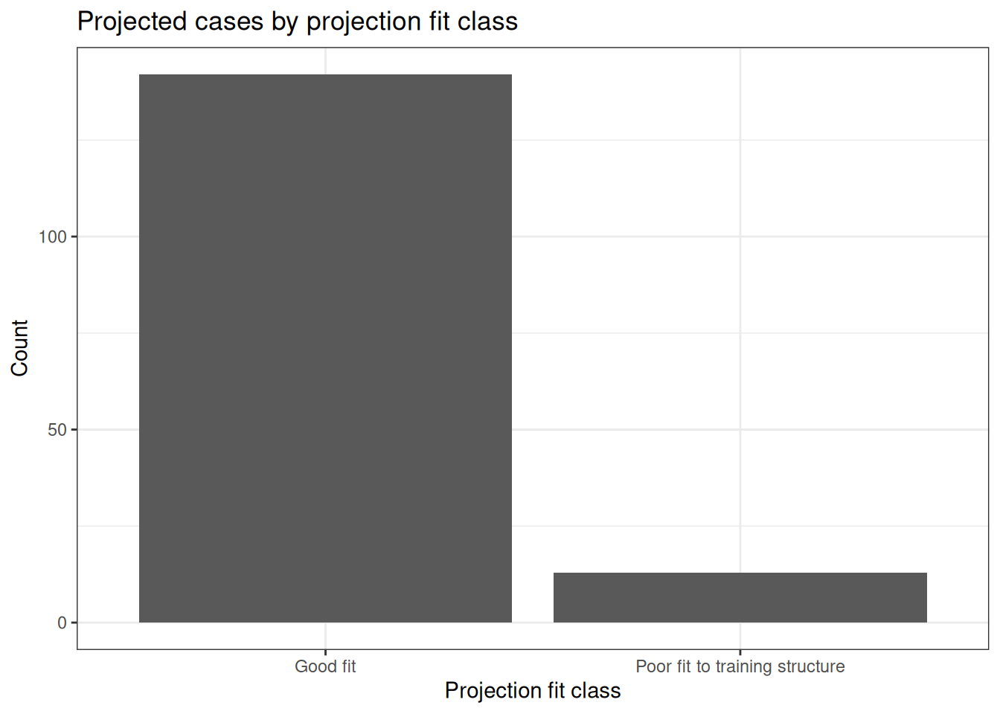

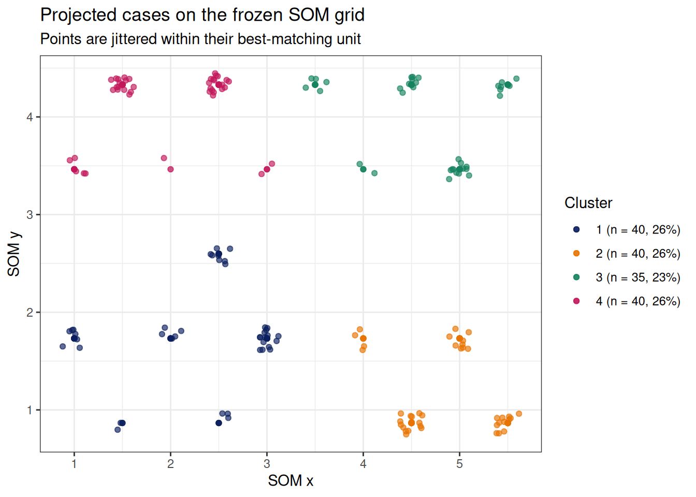

#### Interpreting a SOM projection

The SOM map is a frozen phenotype instrument. Each new model uses one
seeded, full-cohort batch SOM fit from a deterministic initial codebook.
This keeps training fast and reproducible while retaining the fitted
scaling, prototypes, grid, topology, neighbourhood, and node-level
mixture for projection. When dimensions are omitted, the automatic
square grid is k-informed: exploratory fits use `max(k_range)`,
finalized fits use `final_k`, and the engineering default targets about
20 SOM nodes per planned phenotype. That density gives each plausible
phenotype multiple local prototypes without allowing a larger cohort
alone to create a more sparse map or more clinical phenotypes. Sample
size is instead reviewed through occupancy and map-health diagnostics.
Set `som_xdim` and `som_ydim` to preserve a reviewed map design
explicitly; that frozen map is then used for every compared k and all
future projections.

Hard projection uses the Mclust class of the best-matching node. Soft
projection combines Mclust node posterior probabilities from the nearest
`soft_n_nodes` codebook nodes using normalized inverse-squared
standardized feature distances. Both `Cluster_Hard` and `Cluster_Soft`
are retained, while `assignment` controls which is exposed as canonical
`Cluster` (soft-3 by default). `SoftEntropy` is the normalized entropy
of the soft membership probabilities and `SoftMargin` is the gap between
the two largest probabilities. Boundary status
(`SoftMargin < boundary_margin_threshold` or
`SoftEntropy > boundary_entropy_threshold`) is a confidence diagnostic
only; it never removes or suppresses a participant.

`ProbFit` answers the assignment question. Its node-level `prob_*`
columns are Mclust posteriors for codebook nodes; participant-level
`SoftProb_*`, `SoftEntropy`, and `SoftMargin` are proximity-weighted
membership diagnostics. Use `ProbFit$individual` for these values and
for `Cluster`, `Cluster_Hard`, and `Cluster_Soft`.

`ProjectionFit` answers the transportability question: how well do these
new participants fit the frozen training SOM? `ProjectionFit$individual`
contains each participant’s best-matching `SOM_Node`, `SOM_Distance`,
percentile in the training distance distribution, and support flags. A
high distance means the participant is less well represented by the
training map; it does not by itself invalidate the assigned cluster.

`ProjectionFit$out_of_support` lists variables with values below the
observed training minimum or above the observed training maximum.
Projection continues for complete cases, but those values are
extrapolations and should be reviewed. `ProjectionFit$by_cluster` shows
whether that concern concentrates in a specific cluster.

`ProjectionFit$summary` includes `node_occupancy_js_divergence`, a
Jensen–Shannon comparison of the training and projected proportions
mapped to each frozen SOM node. A value of zero means identical node
occupancy; larger values indicate cohort-level use of a different part
of the map. It is not an individual fit score and does not by itself
mean the model failed.

## Mixed and categorical workflows

### Gower distance followed by PAM

Gower distance combines mixed feature types, while PAM represents
clusters by observed medoids ([Gower 1971](#ref-gower1971); [Kaufman and
Rousseeuw 1990](#ref-kaufman1990)). Projection uses training ranges,
levels, and medoids rather than recalculating them in the new cohort.

> **Note**
>
> **When to use it:** numeric, binary, ordinal, and nominal measures
> must be clustered together. **Inspect before naming:** candidate
> silhouette, size balance, medoids, numeric and categorical profiles,
> distance/margin, and subsample stability.

### Latent class analysis

LCA models class-specific categorical response probabilities ([Linzer
and Lewis 2011](#ref-linzer2011)).

> **Note**
>
> **When to use it:** symptom, diagnosis, questionnaire, or assay-call
> items are the phenotype definition. **Inspect before naming:** BIC,
> entropy, class size, response-probability heatmap, posterior
> confidence, and subsample stability. Low posterior confidence is
> evidence of weak class separation.

### MCA followed by Mclust

MCA is a dimension-reduction method for nominal categorical measures
([Greenacre 2017](#ref-greenacre2017)). Each 90% subsample refits MCA
before refitting the mixture.

> **Note**
>
> **When to use it:** several nominal variables form a useful
> lower-dimensional category space. **Inspect before naming:**
> inertia/scree plot, MCA dimensions, mixture fit, score-space
> separation, posterior confidence, and stability.

## Reveal truth for teaching only

The benchmark truth was not used during fitting. ARI is label-invariant,
so cluster numbers do not need to match the truth labels. Strong
simulation recovery confirms that the examples behave as designed; it is
not external or biological validation.

## Compare and interpret profiles

The final label is not the phenotype interpretation. Compare occupancy
and feature distributions across plausible models, then use codebook
labels when describing the profiles.

## Reproducibility

## Candidate metrics and SOM + Mclust workflow

All clustering functions have two modes. `method = "exploratory"`
compares the requested 2:10 candidate settings and returns the fit
table, candidate audit, and AHP advisory only. `method = "finalize"`
requires the selected setting and returns assignments, profiles, fit
diagnostics, and a reusable projection model. AHP is advisory; its
selected row is retained in the table but is never highlighted on a
figure.

`SizeBalance` is the smallest extracted cluster/class size divided by
the largest (1 is perfectly balanced). `MinClusterN`/`MinClassN` is the
smallest group size. Subsample `ARI` measures agreement for the entire
partition, whereas per-cluster Jaccard recovery measures whether each
reference phenotype reappears after refitting. `ReproducibilityScore` is
the mean of subsample mean ARI and mean Jaccard recovery; subsample
success rate is reported separately.

#### Complementary stability diagnostics

Every successful SOM + Mclust 90% subsample refit projects the complete
reference cohort through that refit’s preprocessing, map, and node
mixture before calculating ARI. `StabilityARI_Mean` and
`StabilityARI_P05` are the primary whole-partition measures.
`StabilityARI_NonBoundary` is secondary: it uses the same
reference-defined soft margin/entropy mask in every refit, while the
primary ARI always retains boundary participants. Sampling and model
seeds are recorded for each replicate. `participant_inclusion` reports
the probability that a participant returns to its reference cluster’s
label-matched subsample cluster; `cluster_inclusion` summarizes that
probability by reference cluster.

For complete-case cohorts of 2,000 or fewer participants, `coassignment`
contains the subsample probability that each pair is assigned together
and `Stability$plots$coassignment` displays it. Above that size, the
matrix is skipped with a recorded reason to avoid unbounded memory use.
For density-based methods, noise remains in global partition metrics but
is excluded from inclusion and co-assignment summaries. These
diagnostics explain instability; they cannot make a weak phenotype
stable.

### SOM + Mclust candidate-table fields

[`CreateClusterModel_SOM_MClust()`](https://rdastgh1.github.io/SciDataReportR/reference/CreateClusterModel_SOM_MClust.md)
uses tidyLPA with its mclust backend to fit latent profiles to frozen
SOM node codebooks. `ShowFitTable()` in its help example is only a local
display helper: it rounds a table and displays it with a frozen header;
it is not a SciDataReportR function.

| Field | Definition and interpretation |
|----|----|
| `AIC`, `AWE`, `BIC`, `CAIC`, `CLC`, `KIC`, `SABIC`, `ICL` | Likelihood/information criteria from the LPA fit. Lower values are preferred only when comparing candidates fitted to the same SOM nodes and data. AWE, CLC, and ICL incorporate classification uncertainty ([Celeux and Soromenho 1996](#ref-celeux1996)); KIC is based on symmetric Kullback divergence ([Cavanaugh 1999](#ref-cavanaugh1999)), and SABIC is sample-size adjusted ([Sclove 1987](#ref-sclove1987)). `CAIC` and `CLC` are separate criteria, not one combined `CAICCLC` field. |
| `Entropy` | Classification separation summary; higher values indicate cleaner profile separation. |
| `MinProfileNodeN`, `MaxProfileNodeN` | Integer SOM-node counts in the smallest and largest profile. |
| `MinProfileNodeProportion`, `MaxProfileNodeProportion` | The corresponding node counts divided by the total SOM-node count. These replace tidyLPA’s ambiguous decimal `n_min` and `n_max` fields. |
| `BLRTStatistic`, `BLRTPValue` | Bootstrap likelihood-ratio statistic and raw p-value for comparing the k-profile fit with k - 1 profiles ([Nylund et al. 2007](#ref-nylund2007)). A small p-value supports the additional profile’s statistical fit, but does not by itself establish stability, clinical meaning, or a final choice; it is unavailable for one profile. The last candidate-review panel displays `−log10(BLRTPValue)` and marks `−log10(0.05)`, approximately 1.301. |
| `StabilityARI_Mean` | Mean adjusted Rand index across successful full-pipeline 90% participant subsample refits without replacement. It may be negative: this means agreement is worse than expected by chance, not an error. |
| `StabilityARI_P05` | Fifth percentile of whole-partition ARI across successful refits. It describes the lower tail of reproducibility rather than average agreement. |
| `StabilityARI_NonBoundary`, `StabilityARI_NonBoundary_P05` | Secondary ARI summaries restricted to participants classified as non-boundary in the reference model using the recorded soft margin and entropy thresholds. Boundary participants remain in the primary metrics. |
| `StabilityJaccard_Mean` | Mean label-matched, per-profile Jaccard recovery across successful 90% participant subsample refits without replacement. |
| `ReproducibilityScore` | Equals `StabilityARI_Mean` for SOM + Mclust, so final participant-partition agreement remains the primary reproducibility measure. `StabilitySuccessRate` remains separate. |
| `Reproducibility_scaled` | Min-max rescaling of `ReproducibilityScore` across the current candidate table. It is used only as an AHP input ([Akogul and Erisoglu 2017](#ref-akogul2017)), not as an independently interpretable reproducibility metric. |

| Method | Candidate metrics |
|----|----|
| Mclust, PCA + Mclust, MCA + Mclust | BIC/ICL/AIC (information criteria), entropy, maximum posterior uncertainty, minimum cluster size, size balance |
| K-means, PCA + K-means | WSS, between-cluster sum of squares, silhouette width, Calinski–Harabasz index, minimum size, size balance |
| Gower + PAM | silhouette width, mean distance to assigned medoid, minimum size, size balance |
| Latent class | BIC, AIC, log likelihood, entropy, minimum class size, size balance |
| HDBSCAN and SOM + HDBSCAN | persistence, noise proportion, membership probability, minimum size, size balance; extracted class count is data-derived |
| SOM + Mclust | LPA AIC/BIC/entropy plus SOM node occupancy and subsample stability |

### Candidate-metric definitions for every clustering model

All exploratory `fit_table`s retain the raw metrics produced by their
fitted method. AHP is advisory only: any `*_scaled` field is a
within-search rescaling used to construct its index, not a standalone
scientific result.

| Metric | Definition |
|----|----|
| `Classes` | Requested class/cluster count for fixed-count methods. HDBSCAN variants instead report the data-derived number extracted from each density setting. |
| `MinClusterN` / `MinClassN` | Smallest extracted participant cluster/class size. `SizeBalance` is smallest divided by largest extracted participant group size. SOM + Mclust reports its separate integer node-count and node-proportion fields above. |
| `StabilitySuccessRate` | Proportion of requested 90% subsample refits that successfully complete. It is reported separately and is never multiplied into reproducibility. |
| `StabilityARI_Mean`, `StabilityARI_P05` | Mean and fifth percentile of the adjusted Rand index comparing sampled participants’ full-data and subset-refit assignments ([Hubert and Arabie 1985](#ref-hubert1985)). ARI is invariant to cluster numbering and can be negative when agreement is worse than chance. |
| `StabilityJaccard_Mean`, `StabilityJaccard_Min` | Mean cluster-level Jaccard recovery and the minimum cluster-specific mean recovery across successful 90% participant subsample refits ([Jaccard 1901](#ref-jaccard1901)). |
| `ReproducibilityScore` | Mean of finite `StabilityARI_Mean` and `StabilityJaccard_Mean`; it is unavailable when neither component is estimable. |
| `AHPIndex` / `ahp_index` and `*_scaled` | Advisory within-candidate ranking, calculated from the documented method-specific raw metrics. The recommendation does not finalize a model or alter any fit plot. |

| Pipeline | Method-specific candidate metrics |
|----|----|
| Mclust, PCA + Mclust, MCA + Mclust | `BIC`, `ICL`, `AIC`, entropy, and maximum posterior uncertainty. `BIC` and `ICL` are reported on the scale `mclust` returns them on, where **higher is better** ([Scrucca et al. 2016](#ref-scrucca2016)); `AIC` is reported on the conventional scale, where lower is better. Entropy is higher-is-better and uncertainty is lower-is-better. |
| K-means, PCA + K-means | Within-cluster sum of squares (`WSS`; lower), between-cluster sum of squares (`BSS`; higher), mean silhouette width (higher), and Calinski–Harabasz index (higher) ([Calinski and Harabasz 1974](#ref-calinski1974); [Rousseeuw 1987](#ref-rousseeuw1987)). |
| Gower + PAM | Mean silhouette width (higher) and mean assigned-medoid Gower distance (lower). The latter is a dissimilarity, not a probability ([Gower 1971](#ref-gower1971); [Kaufman and Rousseeuw 1990](#ref-kaufman1990)). |
| Latent class analysis | Log likelihood (higher), `AIC`/`BIC` (lower), and entropy (higher) from the fitted item-response model ([Linzer and Lewis 2011](#ref-linzer2011)). |
| HDBSCAN | `Persistence` (mean cluster persistence; higher), `NoiseProportion` (lower), and the data-derived extracted class count. Membership probability and outlier score are assignment diagnostics, not candidate-selection probabilities ([McInnes et al. 2017](#ref-mcinnes2017)). |
| SOM + Mclust | The LPA criteria, node allocation, BLRT, and subsample metrics defined in the dedicated SOM + Mclust table below. SOM distances describe map representation, not phenotype probability ([Kohonen 1982](#ref-kohonen1982)). |
| SOM + HDBSCAN | Node-codebook HDBSCAN persistence, noise proportion, extracted node-cluster count, and 90% participant subsample stability. `minPts` and epsilon are requested settings; class count is data-derived. |

[`CreateClusterModel_SOM_MClust()`](https://rdastgh1.github.io/SciDataReportR/reference/CreateClusterModel_SOM_MClust.md)
is the explicit SOM + Mclust API.
[`CreateSOMClusterModel()`](https://rdastgh1.github.io/SciDataReportR/reference/CreateClusterModel_SOM_MClust.md)
remains available for compatibility but is deprecated. The SOM first
freezes Z-score preprocessing and learns map nodes; Mclust then clusters
those node prototypes. A SOM distance is the distance, in this frozen
scaled feature space, between a participant and their best-matching map
node. Lower values mean the participant is better represented by the
map; they do not mean stronger membership in a phenotype. Interpret it
against the frozen training distribution only: distances above the
training p95 flag a case that is poorly represented by the training
phenotype space.

`Specification$rng_kind` is R’s
[`RNGkind()`](https://rdrr.io/r/base/Random.html) configuration: the
uniform random number generator, normal random-number generator, and
sampling algorithm in effect when the model was fitted. It is provenance
for reproducing seeded fits, not a clustering tuning parameter.

## How projection works

Every fitted clustering object freezes its preprocessing and records it
in `Specification`; every projected object reports participant-level
diagnostics in `ProjectionFit$individual`, cohort summaries in
`ProjectionFit$summary`, cluster summaries in
`ProjectionFit$by_cluster`, support violations in
`ProjectionFit$out_of_support`, and the applied thresholds in
`ProjectionFit$policy`.

| Workflow | Frozen projection rule | Assignment evidence |
|----|----|----|
| Mclust | Gaussian-mixture [`predict()`](https://rdrr.io/r/stats/predict.html) after training scaling | Posterior probabilities and assigned-component Mahalanobis distance |
| K-means | Nearest frozen centroid | Euclidean centroid distance and second-centroid margin; not a probability |
| PCA/MCA + clustering | Training scaling and frozen reduction, then the fitted downstream model | The downstream model’s metric/probability |
| Gower + PAM | Nearest frozen observed medoid using training ranges and levels | Gower medoid distance and runner-up margin |
| Latent class | Frozen class prevalence and item-response probabilities | Posterior class probabilities |
| HDBSCAN | Conservative nearest in-training-cluster support rule | Nearest-core distance and support flag; **not native HDBSCAN prediction** |
| SOM + Mclust | Frozen scaling, SOM BMU, and node mixture probabilities | BMU distance and node-derived posterior probability |
| SOM + HDBSCAN | Frozen scaling, SOM BMU, and node HDBSCAN label | BMU distance and inherited node cluster/noise label; **not native HDBSCAN prediction** |

`ReproducibilityScore` is the mean of subsample mean ARI and mean
per-cluster Jaccard recovery. ARI summarizes agreement for the whole
partition, whereas Jaccard asks whether each individual phenotype was
recovered. Subsample success rate is reported separately and is not
folded into the score.

Session information

    R version 4.6.1 (2026-06-24)
    Platform: x86_64-pc-linux-gnu
    Running under: Ubuntu 24.04.5 LTS

    Matrix products: default
    BLAS:   /usr/lib/x86_64-linux-gnu/openblas-pthread/libblas.so.3
    LAPACK: /usr/lib/x86_64-linux-gnu/openblas-pthread/libopenblasp-r0.3.26.so;  LAPACK version 3.12.0

    locale:
     [1] LC_CTYPE=C.UTF-8       LC_NUMERIC=C           LC_TIME=C.UTF-8
     [4] LC_COLLATE=C.UTF-8     LC_MONETARY=C.UTF-8    LC_MESSAGES=C.UTF-8
     [7] LC_PAPER=C.UTF-8       LC_NAME=C              LC_ADDRESS=C
    [10] LC_TELEPHONE=C         LC_MEASUREMENT=C.UTF-8 LC_IDENTIFICATION=C

    time zone: UTC
    tzcode source: system (glibc)

    attached base packages:
    [1] stats     graphics  grDevices utils     datasets  methods   base

    other attached packages:
    [1] ggplot2_4.0.3          dplyr_1.2.1            SciDataReportR_21.15.0

    loaded via a namespace (and not attached):
      [1] RColorBrewer_1.1-3     rstudioapi_0.19.0      jsonlite_2.0.0
      [4] datawizard_1.4.0       correlation_0.8.8      magrittr_2.0.5
      [7] estimability_2.0.0     farver_2.1.2           rmarkdown_2.32
     [10] vctrs_0.7.3            paletteer_1.7.0        CompQuadForm_1.4.4
     [13] base64enc_0.1-6        rstatix_1.1.0          htmltools_0.5.9
     [16] forcats_1.0.1          progress_1.2.3         haven_2.5.5
     [19] broom_1.0.13           Formula_1.2-6          parallelly_1.48.0
     [22] htmlwidgets_1.6.4      gsubfn_0.7             plyr_1.8.9
     [25] sandwich_3.1-3         emmeans_2.0.4          zoo_1.9-1
     [28] mime_0.13              lifecycle_1.0.5        pkgconfig_2.0.3
     [31] sjlabelled_1.2.0       R6_2.6.1               fastmap_1.2.0
     [34] future_1.76.0          shiny_1.14.0           digest_0.6.39
     [37] colorspace_2.1-4       rematch2_2.1.2         ps_1.9.3
     [40] patchwork_1.3.2        Hmisc_5.3-0            labeling_0.4.3
     [43] gtsummary_2.6.1        progressr_1.0.0        httr_1.4.9
     [46] abind_1.4-8            compiler_4.6.1         withr_3.0.3
     [49] pander_0.6.6           htmlTable_2.5.0        S7_0.2.2
     [52] backports_1.5.1        viridis_0.6.5          carData_3.0-6
     [55] psych_2.6.9            fastDummies_1.7.6      R.utils_2.13.0
     [58] MASS_7.3-65            scatterplot3d_0.3-45   tools_4.6.1
     [61] pbivnorm_0.6.0         MplusAutomation_1.3    foreign_0.8-91
     [64] otel_0.2.0             httpuv_1.6.17          future.apply_1.20.2
     [67] statsExpressions_2.1.2 nnet_7.3-20            R.oo_1.27.1
     [70] glue_1.8.1             quadprog_1.5-8         dbscan_1.2.7
     [73] nlme_3.1-169           promises_1.5.0         grid_4.6.1
     [76] checkmate_2.3.4        cluster_2.1.8.2        generics_0.1.4
     [79] gtable_0.3.6           labelled_2.16.1        R.methodsS3_1.8.2
     [82] tidyr_1.3.2            aweSOM_1.3             data.table_1.18.6.1
     [85] hms_1.1.4              car_3.1-5              RANN_2.6.3
     [88] pillar_1.11.1          stringr_1.6.0          later_1.4.8
     [91] lattice_0.22-9         ggstatsplot_1.1.2      tidyselect_1.2.1
     [94] knitr_1.52             gridExtra_2.3.1        stats4_4.6.1
     [97] xfun_0.61              texreg_1.40            stringi_1.8.9
    [100] proto_1.0.0            yaml_2.3.12            boot_1.3-32
    [103] evaluate_1.0.5         codetools_0.2-20       nonnest2_0.5-9
    [106] tibble_3.3.1           cli_3.6.6              RcppParallel_6.2.1
    [109] rpart_4.1.27           xtable_1.8-8           parameters_0.29.3
    [112] lavaan_0.7-3           dichromat_2.0-1        Rcpp_1.1.2
    [115] tidySEM_0.2.12         globals_0.20.0         coda_0.19-4.1
    [118] parallel_4.6.1         kohonen_3.0.13         rstantools_2.7.1
    [121] prettyunits_1.2.0      mclust_6.1.3           bayestestR_0.19.0
    [124] listenv_1.1.0          viridisLite_0.4.3      mvtnorm_1.4-2
    [127] scales_1.4.0           insight_1.5.4          purrr_1.2.2
    [130] crayon_1.5.3           rlang_1.3.0            mnormt_2.1.2
    [133] poLCA_1.6.0.2          tidyLPA_2.0.2         

## References

Akogul, Serkan, and Mahir Erisoglu. 2017. “An Approach for Determining
the Number of Clusters in a Model-Based Cluster Analysis.” *Entropy* 19
(9): 452.

Calinski, Tadeusz, and Jerzy Harabasz. 1974. “A Dendrite Method for
Cluster Analysis.” *Communications in Statistics* 3: 1–27.

Cavanaugh, Joseph E. 1999. “A Large-Sample Model Selection Criterion
Based on Kullback’s Symmetric Divergence.” *Statistical Methodology* 61:
165–80.

Celeux, Gilles, and Gilda Soromenho. 1996. “An Entropy Criterion for
Assessing the Number of Clusters in a Mixture Model.” *Journal of
Classification* 13: 195–212.

Gower, John C. 1971. “A General Coefficient of Similarity and Some of
Its Properties.” *Biometrics* 27: 857–71.

Greenacre, Michael. 2017. *Correspondence Analysis in Practice*. 3rd ed.
Chapman; Hall/CRC.

Hubert, Lawrence, and Phipps Arabie. 1985. “Comparing Partitions.”
*Journal of Classification* 2: 193–218.

Jaccard, Paul. 1901. “Etude Comparative de La Distribution Florale Dans
Une Portion Des Alpes Et Des Jura.” *Bulletin de La Société Vaudoise Des
Sciences Naturelles* 37: 547–79.

Jolliffe, Ian T, and Jorge Cadima. 2016. “Principal Component Analysis:
A Review and Recent Developments.” *Philosophical Transactions of the
Royal Society A* 374 (2065): 20150202.

Kaufman, Leonard, and Peter J Rousseeuw. 1990. *Finding Groups in Data:
An Introduction to Cluster Analysis*. Wiley.

Kohonen, Teuvo. 1982. “Self-Organized Formation of Topologically Correct
Feature Maps.” *Biological Cybernetics* 43: 59–69.

Linzer, Drew A, and Jeffrey B Lewis. 2011. “poLCA: An r Package for
Polytomous Variable Latent Class Analysis.” *Journal of Statistical
Software* 42 (10): 1–29.

MacQueen, James B. 1967. “Some Methods for Classification and Analysis
of Multivariate Observations.” *Proceedings of the Fifth Berkeley
Symposium on Mathematical Statistics and Probability* 1: 281–97.

McInnes, Leland, John Healy, and Steve Astels. 2017. “Hdbscan:
Hierarchical Density Based Clustering.” *Journal of Open Source
Software* 2 (11): 205.

Nylund, Karen L, Tihomir Asparouhov, and Bengt O Muthén. 2007. “Deciding
on the Number of Classes in Latent Class Analysis and Growth Mixture
Modeling: A Monte Carlo Simulation Study.” *Structural Equation
Modeling* 14 (4): 535–69.

Rousseeuw, Peter J. 1987. “Silhouettes: A Graphical Aid to the
Interpretation and Validation of Cluster Analysis.” *Journal of
Computational and Applied Mathematics* 20: 53–65.

Sclove, Stanley L. 1987. “Application of Model-Selection Criteria to
Some Problems in Multivariate Analysis.” *Psychometrika* 52: 333–43.

Scrucca, Luca, Michael Fop, Thomas B Murphy, and Adrian E Raftery. 2016.
“Mclust 5: Clustering, Classification and Density Estimation Using
Gaussian Finite Mixture Models.” *Journal of Statistical Software* 71
(11): 1–29.
