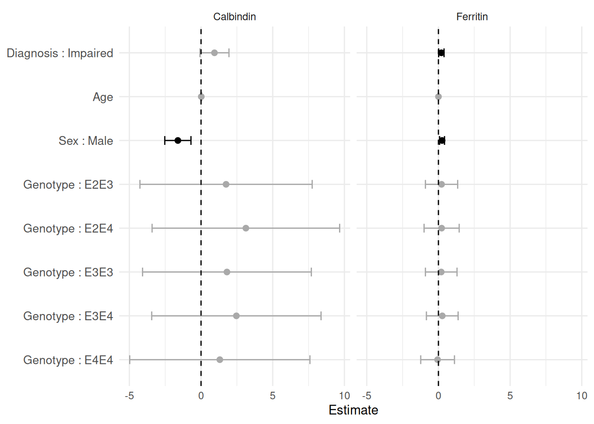
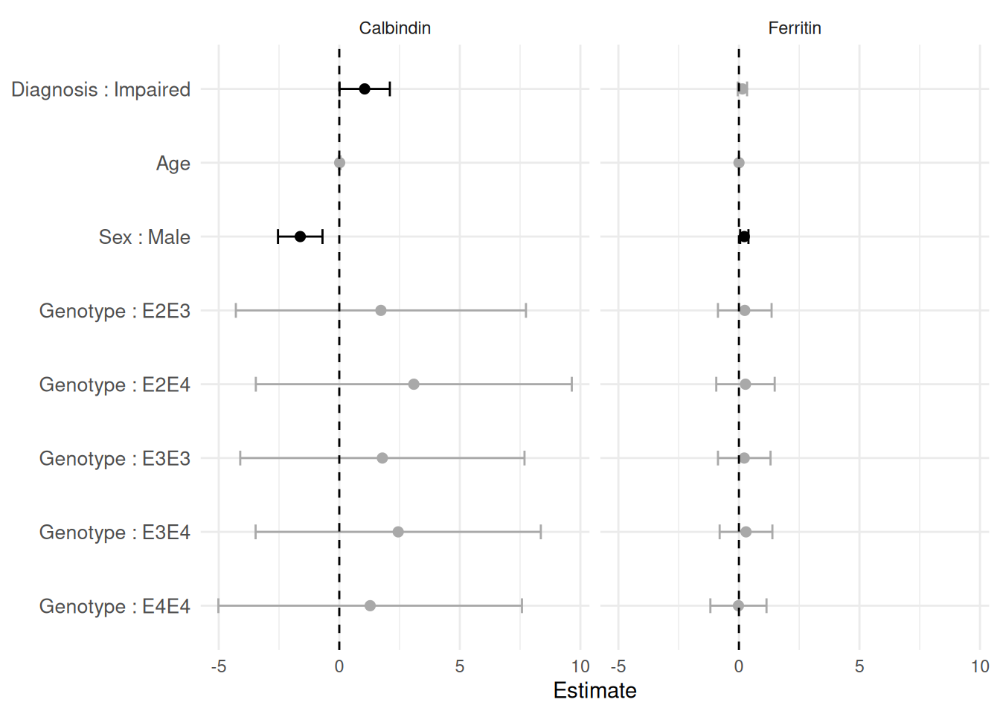

# Screening predictors with MakeUnivariateRegressionTable()

## 1 Overview

[`MakeUnivariateRegressionTable()`](https://rdastgh1.github.io/SciDataReportR/reference/MakeUnivariateRegressionTable.md)
performs large numbers of regression analyses simultaneously and returns
publication-ready summary tables.

This approach is particularly useful for:

- Biomarker screening
- Variable prioritization
- Covariate discovery
- Exploratory analyses
- Hypothesis generation

This vignette demonstrates:

- Running multiple univariate regressions
- Publication-ready tables
- Detailed regression tables
- Covariate adjustment
- Standardized coefficients
- Forest plot visualization

## 2 Load packages

``` r

library(SciDataReportR)
library(dplyr)
```

## 3 Load example data

``` r

data("SampleData")
data("SampleVariableTypes")

RevaluedObj <- RevalueData(
  SampleData,
  SampleVariableTypes
)

df_Revalued <- RevaluedObj$RevaluedData
```

## 4 Define outcomes and predictors

For this example we will evaluate clinical and demographic predictors of
continuous biomarker outcomes.

``` r

OutcomeVars <- c(
  "Calbindin",
  "Ferritin"
)

PredictorVars <- c(
  "Diagnosis",
  "age",
  "sex",
  "Genotype"
)
```

## 5 Create regression tables

``` r

UniObj <- MakeUnivariateRegressionTable(
  data = df_Revalued,
  outcome_vars = OutcomeVars,
  predictor_vars = PredictorVars
)
```

## 6 Publication-ready table

The formatted table is designed for reporting and manuscript
preparation.

``` r

UniObj$FormattedTable
```

[TABLE]

Each outcome has its own column spanner. Effects are displayed as
estimate (95% CI), with significance stars appended and both the effect
and p-value bolded when significant.

## 7 Detailed regression table

The larger table keeps the same wide outcome layout while exposing N,
estimate, standard error, confidence limits, and p-value separately.

``` r

UniObj$LargeTable
```

[TABLE]

This version is often useful during exploratory analyses and quality
control.

## 8 Including covariates

Covariates can be included in every regression model.

For example, MMP7 can be included when evaluating whether associations
are independent of another biomarker.

``` r

UniObj_Covar <- MakeUnivariateRegressionTable(
  data = df_Revalued,
  outcome_vars = OutcomeVars,
  predictor_vars = PredictorVars,
  covariates = "MMP7"
)
```

``` r

UniObj_Covar$FormattedTable
```

[TABLE]

This allows investigators to determine whether associations remain
significant after accounting for potential confounding factors.

## 9 Standardized coefficients

When predictors are measured on different scales, standardized
coefficients can simplify interpretation.

``` r

UniObj_Std <- MakeUnivariateRegressionTable(
  data = df_Revalued,
  outcome_vars = OutcomeVars,
  predictor_vars = PredictorVars,
  Standardize = TRUE
)
```

``` r

UniObj_Std$FormattedTable
```

[TABLE]

Standardized coefficients represent changes in standard deviation units
and facilitate comparison across predictors.

## 10 Accessing model objects

The fitted regression models are returned in the output object.

``` r

names(
  UniObj$ModelSummaries
)
```

    NULL

For example:

``` r

summary(
  UniObj$ModelSummaries$Calbindin$Diagnosis
)
```

    Length  Class   Mode
         0   NULL   NULL 

This allows additional diagnostics and custom analyses.

## 11 Creating a forest plot

A forest plot provides a compact visual summary of regression results.

``` r

ForestPlot <- PlotForestFromTable(
  UniObj
)

ForestPlot
```



Forest plots make it easy to identify:

- Strong predictors
- Significant predictors
- Direction of effects
- Precision of estimates

## 12 Forest plot with covariate adjustment

The same visualization can be generated using adjusted models.

``` r

PlotForestFromTable(
  UniObj_Covar
)
```



Comparing adjusted and unadjusted models can help identify associations
that may be explained by confounding variables.

## 13 Recommended workflow

A common workflow is:

1.  Use
    [`MakeUnivariateRegressionTable()`](https://rdastgh1.github.io/SciDataReportR/reference/MakeUnivariateRegressionTable.md)
    to screen large numbers of predictors.
2.  Review the formatted table.
3.  Compare standardized and unstandardized results.
4.  Add important covariates.
5.  Visualize findings using
    [`PlotForestFromTable()`](https://rdastgh1.github.io/SciDataReportR/reference/PlotForestFromTable.md).
6.  Follow up significant findings using multivariable models.

## 14 Summary

[`MakeUnivariateRegressionTable()`](https://rdastgh1.github.io/SciDataReportR/reference/MakeUnivariateRegressionTable.md)
provides a rapid screening framework for evaluating many predictors
across multiple outcomes.

Key features include:

- Multiple outcomes
- Multiple predictors
- Optional covariate adjustment
- Standardized coefficients
- Publication-ready tables
- Detailed regression output
- Forest plot visualization

## 15 Related functions

- [`PlotForestFromTable()`](https://rdastgh1.github.io/SciDataReportR/reference/PlotForestFromTable.md)
- [`MakeComparisonTable()`](https://rdastgh1.github.io/SciDataReportR/reference/MakeComparisonTable.md)
- [`PlotMiningMatrix()`](https://rdastgh1.github.io/SciDataReportR/reference/PlotMiningMatrix.md)
- [`PlotCorrelationsHeatmap()`](https://rdastgh1.github.io/SciDataReportR/reference/PlotCorrelationsHeatmap.md)
- `CreatePCA()`

## 16 Session information

``` r

sessionInfo()
```

    R version 4.6.1 (2026-06-24)
    Platform: x86_64-pc-linux-gnu
    Running under: Ubuntu 24.04.5 LTS

    Matrix products: default
    BLAS:   /usr/lib/x86_64-linux-gnu/openblas-pthread/libblas.so.3
    LAPACK: /usr/lib/x86_64-linux-gnu/openblas-pthread/libopenblasp-r0.3.26.so;  LAPACK version 3.12.0

    locale:
     [1] LC_CTYPE=C.UTF-8       LC_NUMERIC=C           LC_TIME=C.UTF-8
     [4] LC_COLLATE=C.UTF-8     LC_MONETARY=C.UTF-8    LC_MESSAGES=C.UTF-8
     [7] LC_PAPER=C.UTF-8       LC_NAME=C              LC_ADDRESS=C
    [10] LC_TELEPHONE=C         LC_MEASUREMENT=C.UTF-8 LC_IDENTIFICATION=C

    time zone: UTC
    tzcode source: system (glibc)

    attached base packages:
    [1] stats     graphics  grDevices utils     datasets  methods   base

    other attached packages:
    [1] dplyr_1.2.1            SciDataReportR_21.16.0

    loaded via a namespace (and not attached):
     [1] gt_1.4.0               sass_0.4.10            generics_0.1.4
     [4] tidyr_1.3.2            xml2_1.6.0             rstatix_1.1.0
     [7] gtsummary_2.6.1        lattice_0.22-9         hms_1.1.4
    [10] digest_0.6.39          magrittr_2.0.5         evaluate_1.0.5
    [13] grid_4.6.1             estimability_2.0.0     RColorBrewer_1.1-3
    [16] mvtnorm_1.4-2          fastmap_1.2.0          jsonlite_2.0.0
    [19] backports_1.5.1        Formula_1.2-6          rematch2_2.1.2
    [22] purrr_1.2.2            scales_1.4.0           abind_1.4-8
    [25] cli_3.6.6              labelled_2.16.1        rlang_1.3.0
    [28] withr_3.0.3            yaml_2.3.12            otel_0.2.0
    [31] statsExpressions_2.2.0 tools_4.6.1            datawizard_1.4.1
    [34] rstantools_2.7.1       ggstatsplot_1.1.3      coda_0.19-4.1
    [37] ggplot2_4.0.3          sjlabelled_1.2.0       bayestestR_0.20.0
    [40] forcats_1.0.1          broom_1.0.13           paletteer_1.7.0
    [43] vctrs_0.7.3            R6_2.6.1               lifecycle_1.0.5
    [46] emmeans_2.0.4          snakecase_0.11.1       fs_2.1.0
    [49] car_3.1-5              insight_1.6.0          pkgconfig_2.0.3
    [52] RcppParallel_6.2.1     pillar_1.11.1          gtable_0.3.6
    [55] glue_1.8.1             haven_2.5.5            xfun_0.62
    [58] tibble_3.3.1           tidyselect_1.2.1       parameters_0.30.0
    [61] knitr_1.52             dichromat_2.0-1        farver_2.1.2
    [64] xtable_1.8-8           htmltools_0.5.9        labeling_0.4.3
    [67] carData_3.0-6          rmarkdown_2.32         compiler_4.6.1
    [70] S7_0.2.2              
